<div align="center">

# Learn Git — Visually

**Eleven modules. Twenty animations. Zero dependencies.**

A GitHub-native course that teaches git the way a good field guide does: one real-world analogy, one animation, then the risk — with the pictures doing the explaining.

Every operation is shown as the real commands you'd type, with the key ones backed by a **tested Python function** that drives the actual `git` binary — extracted from [`examples/`](examples/) and covered by a 21-test suite.

[](docs/)
[](assets/anim/)
[](assets/blueprint/)
[](docs/flashcards.md)
[](examples/test_ops.py)
[](docs/quiz.md)
[](https://github.com/manojthati/git-visual-learning/actions/workflows/verify.yml)
[](#no-dependencies)
[](LICENSE)

</div>

---

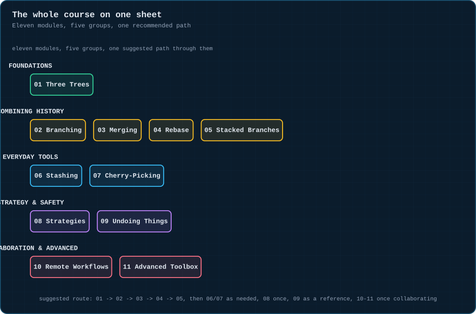

---

## Start here

| | |
|:--|:--|
| 🧭 **New?** | [00 · How to read this repo](docs/00-how-to-read-this.md) — the colour legend and the notation, in two minutes |
| 🎓 **Ready?** | [01 · The Three Trees](docs/01-three-trees.md) — then work straight through |
| ⚡ **In a hurry?** | [📋 Command cheat sheet](docs/cheatsheet-commands.md) and the [risk matrix](assets/infographic/command-risk-matrix.svg) |
| 🧪 **Revising?** | [🃏 31 flashcards](docs/flashcards.md) · [❓ 24-question quiz](docs/quiz.md) |

---

## The learning path

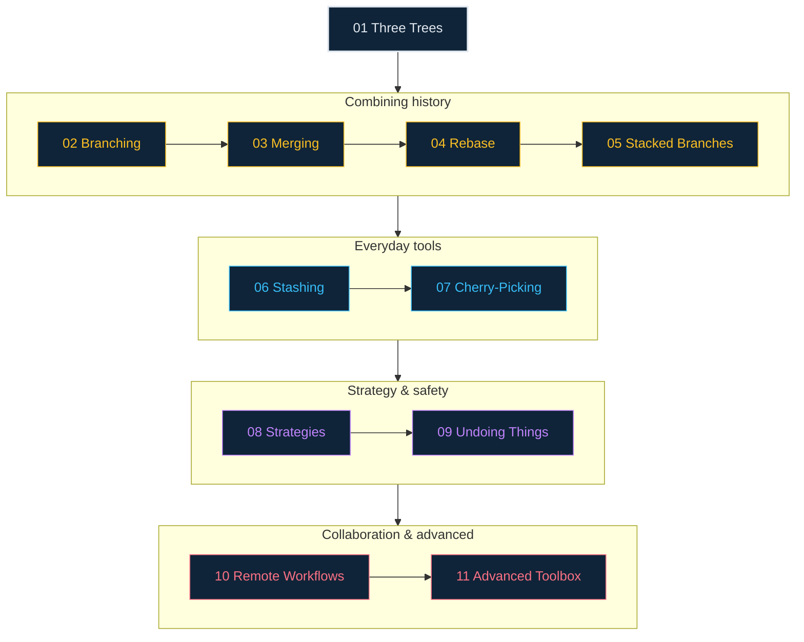

Each module leans on the one before it. Module 05 (stacked branches) is the module everything in modules 02–04 was building toward.

---

## The modules

### 🧱 Foundations

| # | Module | The analogy | Headline |
|:--:|:--|:--|:--|
| 00 | [How to read this repo](docs/00-how-to-read-this.md) | the legend on a map | colours, notation, structure |
| 01 | [The Three Trees](docs/01-three-trees.md) | desk, draft envelope, filing cabinet | `add`/`commit` move forward |

### 🔀 Combining history

| # | Module | The analogy | Headline |
|:--:|:--|:--|:--|
| 02 | [Branching Basics](docs/02-branching-basics.md) | a sticky note on a scroll | a branch is a movable pointer |
| 03 | [Merging](docs/03-merging.md) | two roads becoming one | fast-forward vs. a two-parent commit |
| 04 | [Rebase](docs/04-rebase.md) | picking up a road, re-laying it | same commits, new hashes |
| 05 | [Stacked Branches](docs/05-stacked-branches.md) | driveways in a row | `rebase --onto` is the key move |

### 🧰 Everyday tools

| # | Module | The analogy | Headline |
|:--:|:--|:--|:--|
| 06 | [Stashing](docs/06-stashing.md) | sweeping a desk into a drawer | a LIFO shelf for dirty work |
| 07 | [Cherry-Picking](docs/07-cherry-picking.md) | grabbing one box from a truck | one commit, copied elsewhere |

### 🧭 Strategy & safety

| # | Module | The analogy | Headline |
|:--:|:--|:--|:--|
| 08 | [Branching Strategies](docs/08-branching-strategies.md) | house style for a team | same commands, different shapes |
| 09 | [Undoing Things](docs/09-undoing-things.md) | rewind tape vs. a correction | revert is safe, hard-reset isn't |

### 🌐 Collaboration & advanced

| # | Module | The analogy | Headline |
|:--:|:--|:--|:--|
| 10 | [Remote Workflows](docs/10-remote-workflows.md) | a shared mailbox down the street | fetch ≠ pull |
| 11 | [The Advanced Toolbox](docs/11-advanced-toolbox.md) | a metal detector, wired-up desks | bisect, worktree, rerere |

### 📚 Revision

| Sheet | What it is |
|:--|:--|
| [📋 Command cheat sheet](docs/cheatsheet-commands.md) | every command in the repo, one page |
| [🃏 Flashcards](docs/flashcards.md) | all 31 cards, grouped by module |
| [❓ Quiz bank](docs/quiz.md) | 24 questions across three difficulty levels |

---

## The animation gallery

Every key operation in the course, animated. All 20 loop with a pause at the start and end so you can read the state.

<details open><summary><b>🧱 Foundations — 2 animations</b></summary>

| | |
|:--|:--|
|  |  |

</details>

<details><summary><b>🔀 Combining history — 8 animations</b></summary>

| | |
|:--|:--|
|  |  |
|  |  |
|  |  |
|  |  |

</details>

<details><summary><b>🧰 Everyday tools — 3 animations</b></summary>

| | |
|:--|:--|
|  |  |
|  | |

</details>

<details><summary><b>🧭 Strategy & safety — 3 animations</b></summary>

| | |
|:--|:--|
|  |  |
|  | |

</details>

<details><summary><b>🌐 Collaboration & advanced — 4 animations</b></summary>

| | |
|:--|:--|
|  |  |
|  | 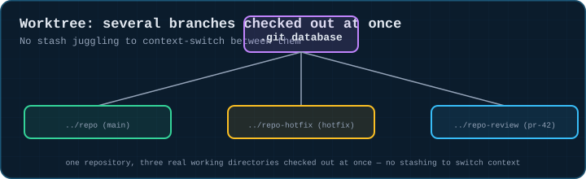 |

</details>

---

## Reference sheets

<details><summary><b>📊 The five infographics</b></summary>

| Sheet | What it answers |
|:--|:--|
|  | the whole course on one sheet |
| 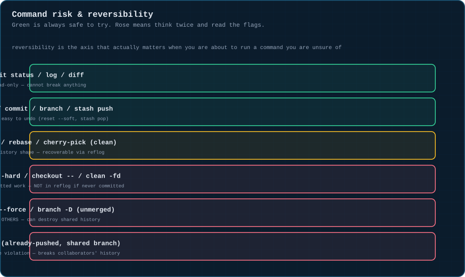 | how dangerous is this command, and can I undo it |
| 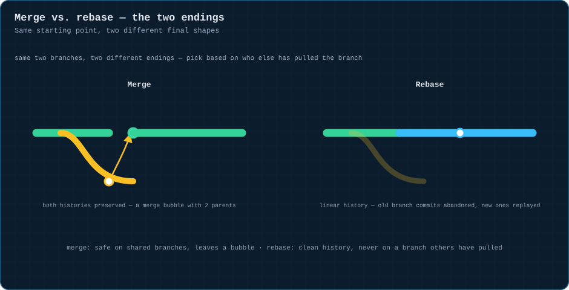 | the two different endings for the same two branches |
| 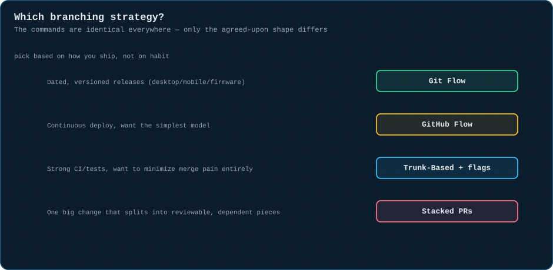 | which branching strategy fits how your team ships |
| 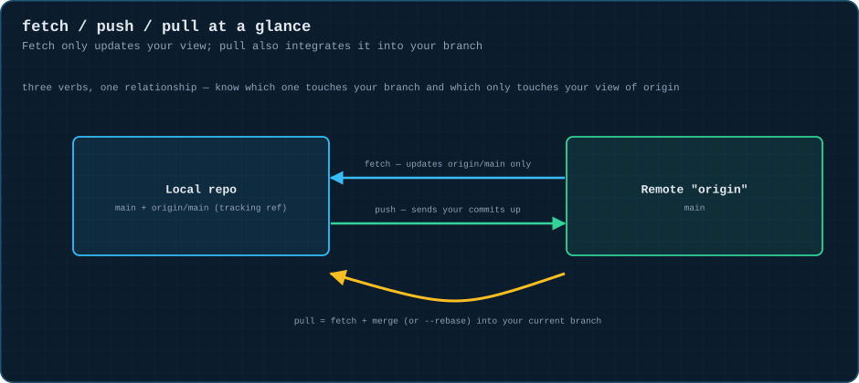 | fetch, push and pull, at a glance |

</details>

Eleven **blueprints** — one static diagram per module — live in [`assets/blueprint/`](assets/blueprint/) and are embedded in their modules.

---

## No dependencies

This repo has no build step, no package manager, no JavaScript and no external assets.

- Every animation is a **plain `.svg` file** with CSS `@keyframes` written inside it.
- They render identically on GitHub, in an offline clone, and in the Pages gallery.
- Mermaid diagrams use `flowchart` syntax, which GitHub renders natively.
- Clone it and open `index.html` in any browser — or just read the markdown.

Twelve repository invariants are checked by `tools/verify.py` (stdlib only, no install) and run in CI on every push — see [CONTRIBUTING](CONTRIBUTING.md).

```bash
git clone https://github.com/manojthati/git-visual-learning.git
cd git-visual-learning
open index.html          # the gallery; or start at docs/00-how-to-read-this.md
```

---

## Credit

The analogy-first teaching approach follows the same spirit as the companion course, [**Learn Data Structures & Algorithms — Visually**](https://github.com/manojthati/data-structures-visualization). The source material for the command walkthroughs is a standing personal Git field guide; the diagrams, prose, mindmaps and exercises here are original work built to match it.

Licensed [MIT](LICENSE). Corrections and additional modules welcome — see [CONTRIBUTING.md](CONTRIBUTING.md).
