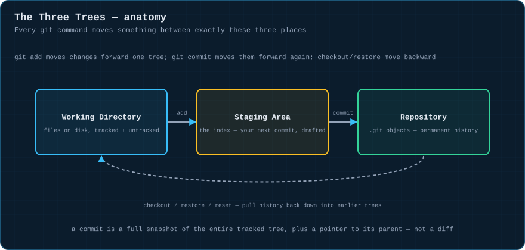
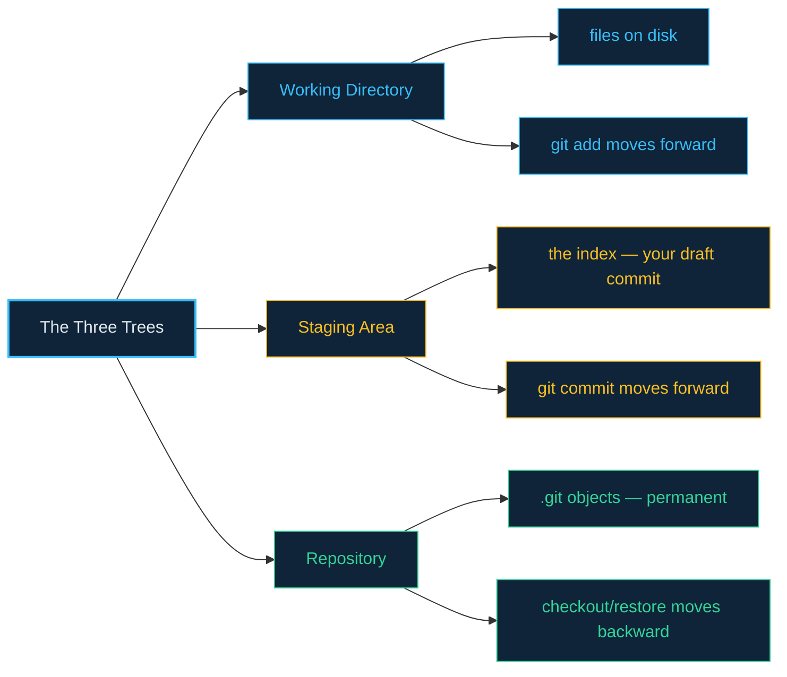

# 01 · The Three Trees

> **The analogy.** Every file you track lives in exactly three places: your desk (the working directory), a draft envelope you're filling before you seal it (the staging area), and a filing cabinet of everything you've ever sealed (the repository). Every git command is just moving paper between these three spots.

---

## 🎞️ Animation

**A change moves forward, one tree at a time.**



**Two different diffs compare two different pairs of trees.**



---

## 📐 Blueprint



---

## 🗺️ Mindmap



---

## ⚙️ Commands

**See what's different across the three trees right now.**

```bash
git status
git diff                 # working dir  vs  staging area
git diff --staged        # staging area vs  last commit (repository)
```

**Working dir → staging area.**

```bash
git add file.txt
git add .                 # everything, be careful
git add -p                # interactively choose hunks
```

**Staging area → repository.**

```bash
git commit -m "message"
git commit -am "message"  # add + commit tracked files in one step
```

**Look at history.**

```bash
git log
git log --oneline --graph --all
```

A commit is **not** "a diff of what changed" — it's a full snapshot of the entire tracked tree at that moment, plus a pointer to its parent commit(s). That detail is what makes branching, merging and rebasing make sense later. The function below proves the three-tree model by snapshotting `git status` at each boundary:

<!-- py:ops_three_trees:move_through_trees -->
```python
def move_through_trees(repo: str, filename: str, content: str, message: str) -> dict[str, str]:
    """Walk one change through working dir -> staging -> repository."""
    write(repo, filename, content)
    dirty = run(["status", "--porcelain"], repo).strip()      # working dir only: untracked/modified
    run(["add", filename], repo)
    staged = run(["status", "--porcelain"], repo).strip()     # staged for the next commit
    run(["commit", "-q", "-m", message], repo)
    clean = run(["status", "--porcelain"], repo).strip()      # repository: tree is clean again
    return {"after_write": dirty, "after_add": staged, "after_commit": clean}
```
<!-- /py -->

And this one proves `git diff` and `git diff --staged` really do compare two different pairs of trees:

<!-- py:ops_three_trees:diff_scopes -->
```python
def diff_scopes(repo: str, filename: str, before: str, after: str) -> dict[str, str]:
    """git diff and git diff --staged compare two different pairs of trees."""
    write(repo, filename, before)
    run(["add", filename], repo)
    run(["commit", "-q", "-m", "base"], repo)
    write(repo, filename, after)                               # dirties the working dir only
    unstaged = run(["diff", "--stat"], repo).strip()           # working dir vs staging
    run(["add", filename], repo)
    staged = run(["diff", "--staged", "--stat"], repo).strip()  # staging vs last commit (repository)
    return {"working_vs_staging": unstaged, "staging_vs_commit": staged}
```
<!-- /py -->

Both are covered by [`examples/test_ops.py`](../examples/test_ops.py).

---

## ⚠️ Risk & reversibility

| Command | Risk | Reversible? |
|:--|:--:|:--|
| `git status`, `git diff`, `git log` | none | read-only |
| `git add` | low | `git restore --staged <file>` undoes it |
| `git commit` | low | `git reset --soft HEAD~1` undoes it, keeping the changes staged |
| `git checkout -- <file>` / `git restore <file>` | **high** | discards working-dir edits with **no safety net** — they were never committed, so reflog can't help |

---

## ⚖️ Trade-offs

| ✅ Lean on the three-tree model when | ❌ It stops helping when |
|:--|:--|
| you want to stage *part* of a messy change (`git add -p`) | you've already memorised "add then commit" as one ritual and never split them |
| you're debugging "why didn't my change commit" | — the model is free; there's no real downside to understanding it |

> **In practice:** almost every git confusion ("I committed but it's not there", "my diff is empty", "git add did nothing") resolves the instant you ask "which of the three trees am I actually looking at right now?"

---

## 🃏 Flashcards

<details><summary>What exactly is a git commit — a diff, or something else?</summary>

A **full snapshot** of the entire tracked tree at that point, plus a pointer to its parent commit(s). Git computes diffs on demand by comparing two snapshots; it doesn't store them.
</details>

<details><summary>What's the difference between <code>git diff</code> and <code>git diff --staged</code>?</summary>

`git diff` compares the **working directory** to the **staging area**. `git diff --staged` compares the **staging area** to the **last commit** (the repository). They can show completely different things if you've staged part of a change.
</details>

<details><summary>If <code>git add</code> stages a file and you then edit it again, what does <code>git status</code> show?</summary>

The file appears in **both** "changes to be committed" (the version you staged) and "changes not staged for commit" (your newer edit) — because staging snapshots the file at the moment of `git add`, not a live link to it.
</details>

<details><summary>Why is <code>git checkout -- file.txt</code> more dangerous than <code>git reset HEAD~1</code>?</summary>

`reset` only ever discards committed state, which reflog can usually recover. `checkout -- file.txt` (or `git restore file.txt`) discards **uncommitted working-directory edits**, which were never snapshotted anywhere — there is no reflog entry to fall back on.
</details>

---

## ❓ Quiz

**1.** You run `git add file.txt`, then edit `file.txt` again without re-adding it, then `git commit`. What got committed?

<details><summary>Answer</summary>

**The staged version** — the one at the moment of `git add`, not your newest edit. The newest edit is still sitting, uncommitted, in the working directory. This is the single most common "where did my change go?" confusion.
</details>

**2.** Why can't `git diff` (no flags) show you what's about to be committed?

<details><summary>Answer</summary>

Because plain `git diff` compares the working directory to staging, not staging to the repository. Use `git diff --staged` to see exactly what the next `git commit` will record.
</details>

---

⬅️ [00 · How to read this repo](00-how-to-read-this.md) · [🏠 Index](../README.md) · [02 · Branching Basics](02-branching-basics.md) ➡️
