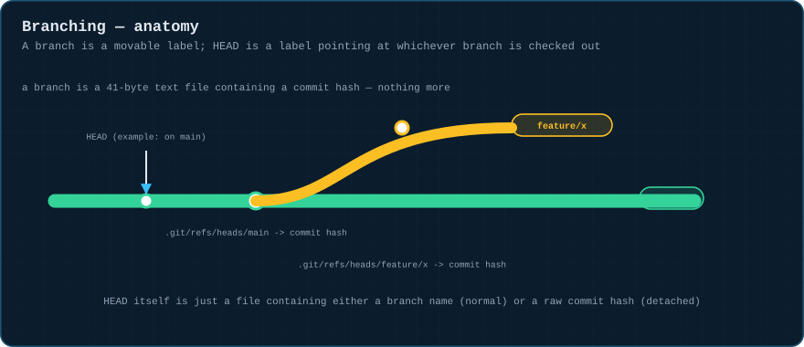
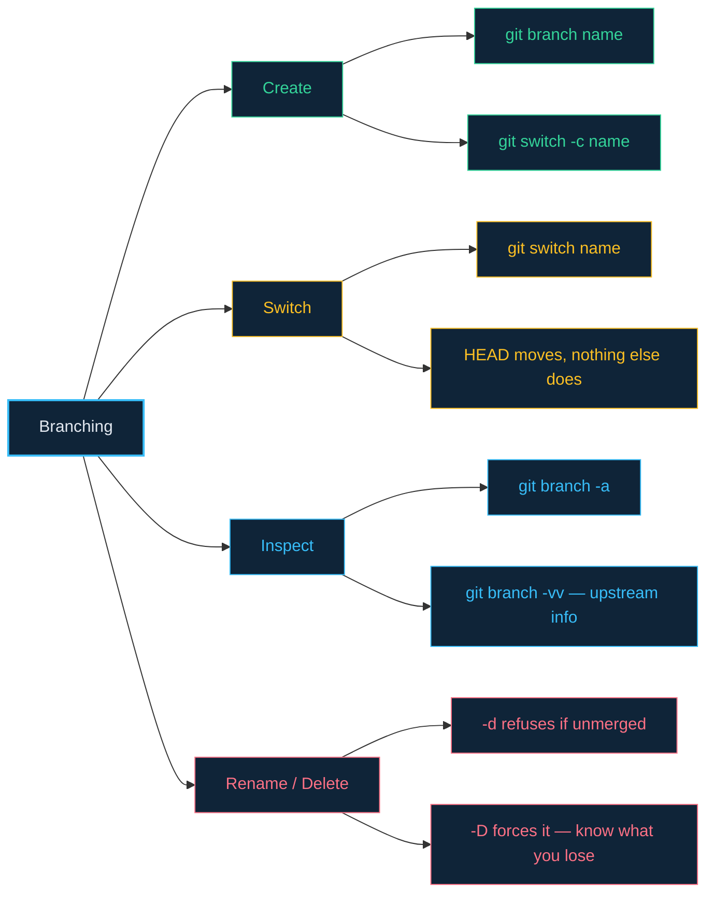

# 02 · Branching Basics

> **The analogy.** A branch is a sticky note with a name on it, stuck onto one point in a long scroll of history. `HEAD` is a second sticky note that says "you are here," stuck onto whichever branch's note you're currently following. Move the HEAD note, and you've "switched branches" — nothing about the scroll itself changed.

---

## 🎞️ Animation

**Creating a branch plants a new label at the current commit.**



**HEAD is a pointer to a pointer.**



---

## 📐 Blueprint



---

## 🗺️ Mindmap



---

## ⚙️ Commands

**Create and switch.**

```bash
git branch feature/x        # create, stay on current branch
git switch feature/x         # move HEAD to it (modern)
git checkout feature/x       # move HEAD to it (classic, does more)
git switch -c feature/x      # create + switch in one step
git checkout -b feature/x    # same, classic spelling
```

**Inspect.**

```bash
git branch -a                 # all local + remote branches
git branch -vv                 # with last commit + upstream tracking info
```

**Rename / delete.**

```bash
git branch -m old-name new-name
git branch -d feature/x       # safe delete — refuses if unmerged
git branch -D feature/x       # force delete — know what you're discarding
```

<!-- py:ops_branching:create_and_switch -->
```python
def create_and_switch(repo: str, branch: str) -> dict[str, object]:
    """git switch -c: create a branch at the current commit, move HEAD onto it."""
    fork_point = rev(repo)
    run(["switch", "-c", branch], repo)
    return {
        "head_branch": current_branch(repo),
        "branch_points_at_fork": rev(repo, branch) == fork_point,
    }
```
<!-- /py -->

---

## ⚠️ Risk & reversibility

| Command | Risk | Reversible? |
|:--|:--:|:--|
| `git branch` / `switch` / `switch -c` | none | branches are free; delete the label any time |
| `git branch -d` | low | refuses on unmerged work — it's asking you to confirm you meant it |
| `git branch -D` | **high** | force-deletes even unmerged commits — they're unreachable the instant no branch or tag points at them, and fall out of `reflog` after ~90 days |

---

## ⚖️ Trade-offs

| ✅ Make a new branch when | ❌ Don't bother when |
|:--|:--|
| the work might not land, or needs isolated review | it's a one-line fix you're committing straight to trunk (see [module 08](08-branching-strategies.md)) |
| you want to experiment without risking main | you're the only contributor and ship directly, deliberately |

> **In practice:** branches cost nothing in git — no copy of your files is made. Creating ten speculative branches to compare approaches is normal and cheap; the discipline that matters is deleting the ones that lost.

---

## 🃏 Flashcards

<details><summary>What is a git branch, physically?</summary>

A small text file under `.git/refs/heads/` containing a 40-character commit hash. Nothing more — no copy of your files, no extra storage beyond that one pointer.
</details>

<details><summary>What does HEAD point to, normally?</summary>

A **branch**, not directly to a commit. The branch then points to the commit. Moving HEAD to a different branch (`git switch`) is what "checking out a branch" means.
</details>

<details><summary>What is "detached HEAD," and how do you get there?</summary>

HEAD pointing directly at a commit hash instead of at a branch name — e.g. `git checkout abc1234`. Any new commits you make are reachable only by that raw hash until you create a branch there; they're one `git gc` away from being lost if you move away without doing so.
</details>

<details><summary>Why does <code>git branch -d</code> sometimes refuse to delete a branch?</summary>

Because the branch has commits that aren't reachable from any other branch — deleting it would make them effectively unrecoverable. `-D` overrides the check; use it only once you're sure.
</details>

---

## ❓ Quiz

**1.** You run `git switch -c feature/x` while on `main` at commit `abc123`. What does `feature/x` point to right now?

<details><summary>Answer</summary>

**`abc123`** — the exact same commit `main` was on. A new branch always starts pointing at whatever commit was checked out when you created it; it only diverges once you commit on it.
</details>

**2.** You delete a branch with `git branch -D` by mistake. Is the work gone?

<details><summary>Answer</summary>

**Probably not, yet.** The commits are still in `.git/objects` and their hash is in your local `reflog` (and in the pre-delete entry for HEAD if you were on that branch). `git branch recovered <hash>` restores it — see [module 09](09-undoing-things.md).
</details>

---

⬅️ [01 · The Three Trees](01-three-trees.md) · [🏠 Index](../README.md) · [03 · Merging](03-merging.md) ➡️
