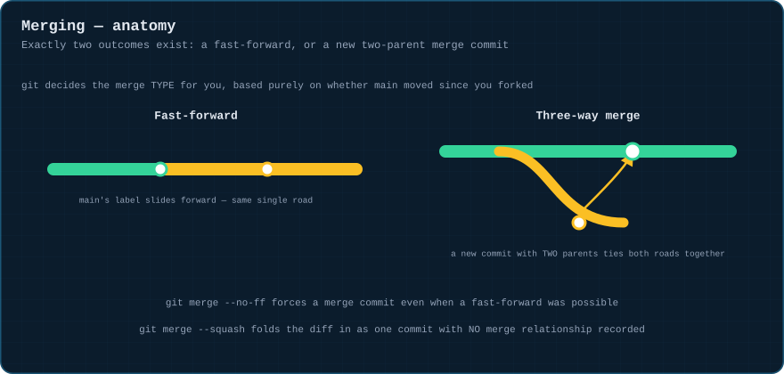
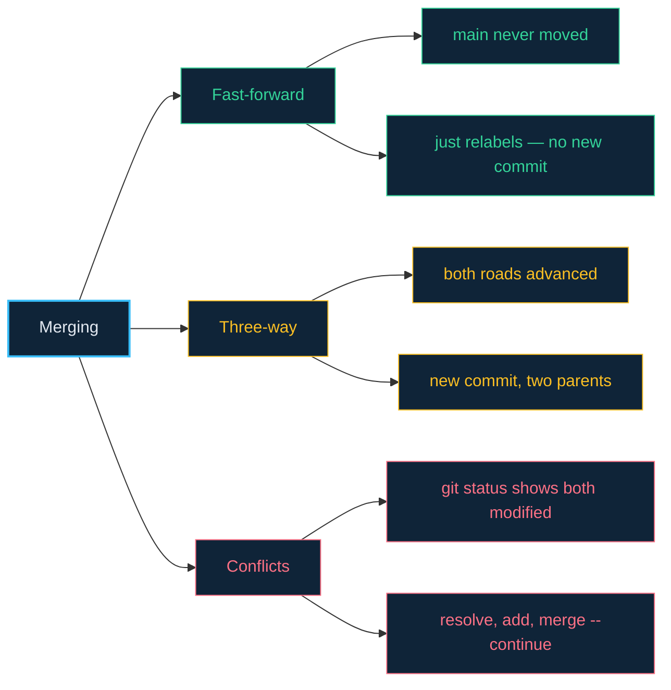

# 03 · Merging — Fast-Forward vs. Three-Way

> **The analogy.** Two roads need to become one. If the main road never moved while yours was being built, the city just repaints the main road's sign onto your road — no construction needed (fast-forward). If the main road kept paving while you were away, a new junction has to be built where both roads physically meet (a three-way merge).

---

## 🎞️ Animation

**Fast-forward: main's label just slides down the existing road.**



**Three-way: both roads kept moving, so a new commit ties them together.**



---

## 📐 Blueprint



---

## 🗺️ Mindmap



---

## ⚙️ Commands

```bash
git checkout main
git merge feature/x            # fast-forward if possible, else a merge commit
git merge --no-ff feature/x    # force a merge commit even when FF was possible
git merge --squash feature/x   # bring in the diff as ONE new commit, no merge history
```

**When a merge conflicts.**

```bash
git status                      # shows which files are "both modified"
#   edit the files, remove the <<<<<<< ===== >>>>>>> markers
git add resolved-file.txt
git merge --continue            # or just: git commit
git merge --abort                # bail out completely, back to pre-merge state
```

> **`--squash` does not record a merge relationship.** Git will happily let you "merge" that branch again later and show you the same diff as new — fine for a throwaway branch, confusing for a long-lived one.

<!-- py:ops_merging:fast_forward_merge -->
```python
def fast_forward_merge(repo: str) -> dict[str, object]:
    """Possible only when main never moved while feature was being built."""
    commit(repo, "a.txt", "1", "base")
    run(["switch", "-c", "feature"], repo)
    commit(repo, "b.txt", "2", "feature work")
    run(["switch", "main"], repo)
    before = rev(repo, "main")
    run(["merge", "feature"], repo)
    after = rev(repo, "main")
    return {"main_advanced": before != after, "main_now_equals_feature": after == rev(repo, "feature")}
```
<!-- /py -->

<!-- py:ops_merging:three_way_merge -->
```python
def three_way_merge(repo: str) -> dict[str, object]:
    """Both branches moved, so git ties them together with a new two-parent commit."""
    commit(repo, "a.txt", "1", "base")
    run(["switch", "-c", "feature"], repo)
    commit(repo, "b.txt", "2", "feature work")
    run(["switch", "main"], repo)
    commit(repo, "c.txt", "3", "main moved on too")
    run(["merge", "--no-edit", "feature"], repo)
    parents = run(["log", "-1", "--format=%P"], repo).strip().split()
    return {"merge_commit_parent_count": len(parents), "history": log_messages(repo)}
```
<!-- /py -->

---

## ⚠️ Risk & reversibility

| Command | Risk | Reversible? |
|:--|:--:|:--|
| `git merge` (clean, no conflicts) | low | `git reset --hard ORIG_HEAD` undoes an unpushed merge entirely |
| `git merge` with conflicts, mid-resolution | low | `git merge --abort` returns you to exactly the pre-merge state |
| `git merge --squash` | medium | no merge relationship is recorded — re-merging the source branch later shows the whole diff again as if new |

---

## ⚖️ Trade-offs

| ✅ Merge when | ❌ Reach for rebase instead when |
|:--|:--|
| the branch is shared/public — merge never rewrites history | it's your own unpublished branch and you want a linear log ([module 04](04-rebase.md)) |
| you want an honest record that two lines of work combined at a point in time | the merge bubbles are making `git log --graph` unreadable |

---

## 🃏 Flashcards

<details><summary>What determines whether a merge is fast-forward or three-way?</summary>

Whether the target branch (usually `main`) has moved since the source branch forked off it. If it hasn't moved, fast-forward is possible — git just slides the label. If it has, a three-way merge commit is required.
</details>

<details><summary>How many parents does a merge commit have?</summary>

**Two** (or more, for an unusual octopus merge) — one pointing at each branch being combined. This is what makes it structurally different from every other commit, which has exactly one parent.
</details>

<details><summary>What's the practical downside of <code>git merge --squash</code>?</summary>

It discards the individual commit history of the source branch and records no merge relationship at all — git will treat the branch as never having been merged, so a second genuine merge later shows the whole diff as new.
</details>

---

## ❓ Quiz

**1.** `main` is at commit A. You branch `feature` from A, add commit B. Nobody touches `main`. You merge `feature` into `main`. What kind of merge is this?

<details><summary>Answer</summary>

**Fast-forward.** `main` never moved past A, so git simply moves `main`'s label up to B — no new commit is created.
</details>

**2.** Same setup, but `main` gets commit C before you merge. What happens now?

<details><summary>Answer</summary>

**A three-way merge.** Git creates a new commit with two parents (B and C) to tie both lines of history together — a fast-forward is no longer possible because `main` has its own independent commit.
</details>

---

⬅️ [02 · Branching Basics](02-branching-basics.md) · [🏠 Index](../README.md) · [04 · Rebase](04-rebase.md) ➡️
