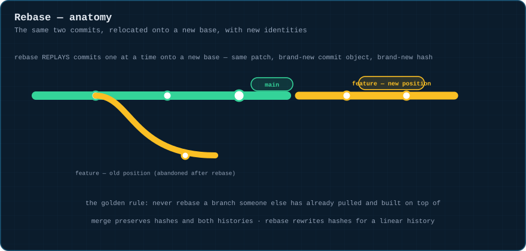
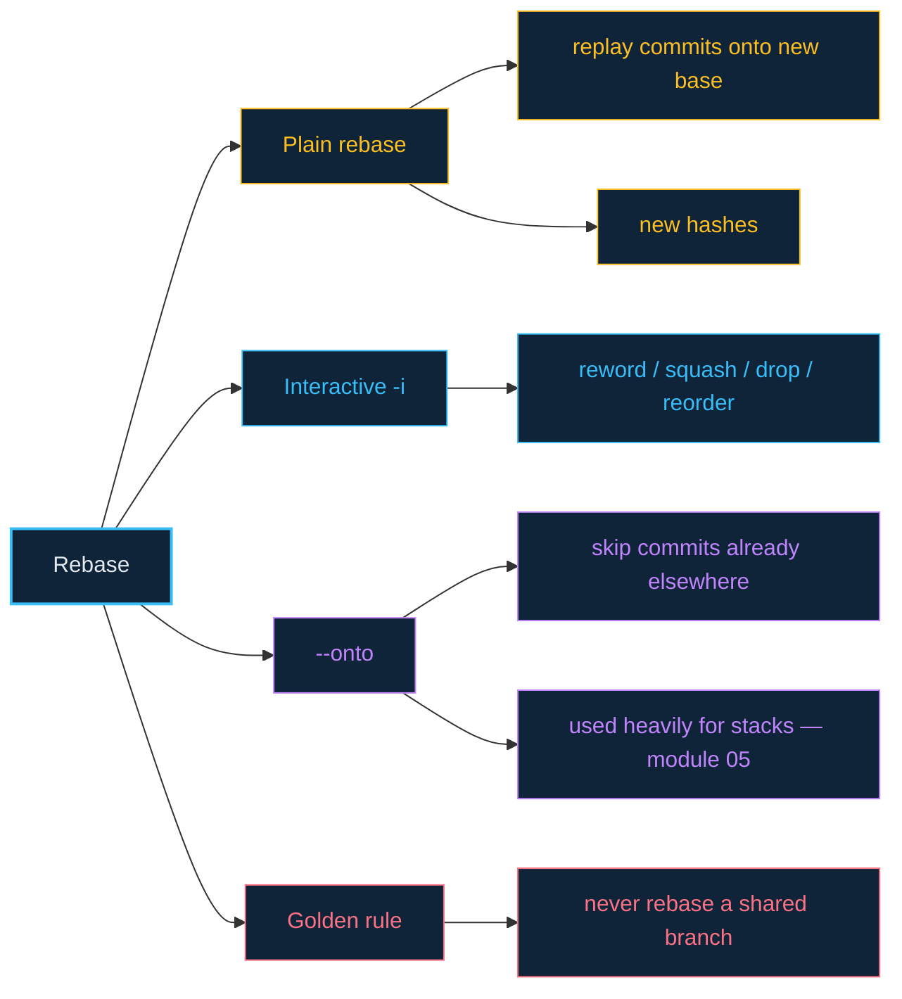

# 04 · Rebase — Rewriting History Onto a New Base

> **The analogy.** Merge keeps both histories and builds a junction where they meet. Rebase *picks your road up entirely* and sets it back down starting from wherever the main road currently ends — replaying each of your commits, one at a time, as if you'd started there all along. Same destinations, brand-new road surface.

---

## 🎞️ Animation

**Rebase replays commits onto a new base — new hashes, same changes.**



**`rebase --onto` relocates a branch precisely, skipping commits already folded elsewhere.**



---

## 📐 Blueprint



---

## 🗺️ Mindmap



---

## ⚙️ Commands

```bash
git checkout feature/x
git rebase main                      # replay feature/x's commits onto tip of main
git rebase -i main                    # interactive: reword / squash / drop / reorder commits
git rebase --continue                  # after fixing a conflict mid-rebase
git rebase --skip                      # drop the commit currently causing the conflict
git rebase --abort                      # bail out, back to pre-rebase state

# move a branch from one base to another directly (used heavily in module 05)
git rebase --onto new-base old-base feature/x
```

| Situation | Merge | Rebase |
|:--|:--|:--|
| Shared / public branch | ✓ safe — never rewrites history | ✗ never rebase a branch others have pulled |
| Your own feature branch, before review | leaves a merge bubble | ✓ clean, linear history |
| Conflict resolution effort | resolve once, in the merge commit | may need to resolve the same conflict per replayed commit |
| Commit hashes | unchanged | rewritten — anything built on the old ones breaks |

> **The golden rule:** don't rebase a branch that someone else has already pulled and built on top of, unless you've agreed on it (force-push coordination) — rebase rewrites commits, and rewritten commits can't be reconciled by git the normal way.

<!-- py:ops_rebase:rebase_onto_main -->
```python
def rebase_onto_main(repo: str) -> dict[str, object]:
    """Same two commits, relocated onto main's current tip, with new identities."""
    commit(repo, "a.txt", "1", "base")
    run(["switch", "-c", "feature"], repo)
    old_c1 = commit(repo, "b.txt", "2", "feature: first change")
    old_c2 = commit(repo, "c.txt", "3", "feature: second change")
    run(["switch", "main"], repo)
    commit(repo, "d.txt", "4", "main moved on while feature was being built")
    run(["switch", "feature"], repo)
    run(["rebase", "main"], repo)
    new_c1, new_c2 = run(["log", "--format=%H", "main..feature"], repo).strip().splitlines()[::-1]
    return {
        "hashes_changed": {old_c1, old_c2}.isdisjoint({new_c1, new_c2}),
        "messages_preserved": log_messages(repo, "feature")[:2] == ["feature: second change", "feature: first change"],
        "feature_now_descends_from_main": run_ok(["merge-base", "--is-ancestor", "main", "feature"], repo).returncode == 0,
    }
```
<!-- /py -->

---

## ⚠️ Risk & reversibility

| Command | Risk | Reversible? |
|:--|:--:|:--|
| `git rebase main` on your own unpublished branch | low | `git rebase --abort` mid-way; `git reset --hard ORIG_HEAD` after |
| `git rebase -i` dropping/squashing commits | medium | the dropped commits are still in `reflog` until git's GC eventually collects them |
| rebasing a branch others have already pulled | **high** | not reversible for *them* without manual reconciliation — this is the golden-rule violation |

---

## ⚖️ Trade-offs

| ✅ Rebase when | ❌ Merge instead when |
|:--|:--|
| it's your own branch, not yet shared, and you want a clean linear log | the branch is shared/public — rebase there breaks collaborators |
| you're about to open a PR and want to clean up "wip" commits first (`rebase -i`) | you want an honest record that two lines of work combined at a specific point |

---

## 🃏 Flashcards

<details><summary>What does rebase actually do to a commit?</summary>

It re-applies the **same change** as a **brand-new commit object** — same diff and message, different parent, different hash. The original commit is abandoned, not modified; it still exists until nothing points at it and git garbage-collects it.
</details>

<details><summary>Why is rebasing a shared branch dangerous?</summary>

Because the rewritten commits have new hashes. Anyone who already pulled the old commits now has history that has diverged in a way `git pull` can't reconcile normally — they'd need to force-reset to match, discarding any of their own work built on the old commits.
</details>

<details><summary>What does <code>rebase --onto new old branch</code> do differently from plain <code>rebase new</code>?</summary>

Plain rebase replays *every* commit `branch` has on top of `new`. `--onto` replays only the commits that are on `branch` but **not** on `old` — letting you skip a chunk of history that's already present elsewhere. See [module 05](05-stacked-branches.md) for the exact scenario this exists for.
</details>

---

## ❓ Quiz

**1.** After `git rebase main` on `feature`, does `feature`'s old commit still exist anywhere?

<details><summary>Answer</summary>

**Yes, briefly.** The old commits are unreachable from any branch but still exist as objects, and their hashes are in your local `reflog` — recoverable for a while (`git reflog`, see [module 09](09-undoing-things.md)) until a future `git gc` collects truly unreachable objects.
</details>

**2.** You and a teammate both pulled `feature`. You rebase it locally and force-push. What breaks for them?

<details><summary>Answer</summary>

**Their next pull.** Their local `feature` still points at the old commits; the remote now has different ones with the same names but different hashes. A plain `git pull` will try to merge two unrelated-looking histories — they need `git fetch` + `git reset --hard origin/feature` (discarding any local work) or a coordinated rebase of their own.
</details>

---

⬅️ [03 · Merging](03-merging.md) · [🏠 Index](../README.md) · [05 · Stacked Branches](05-stacked-branches.md) ➡️
