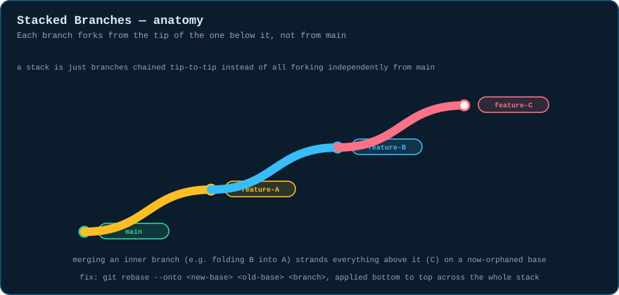
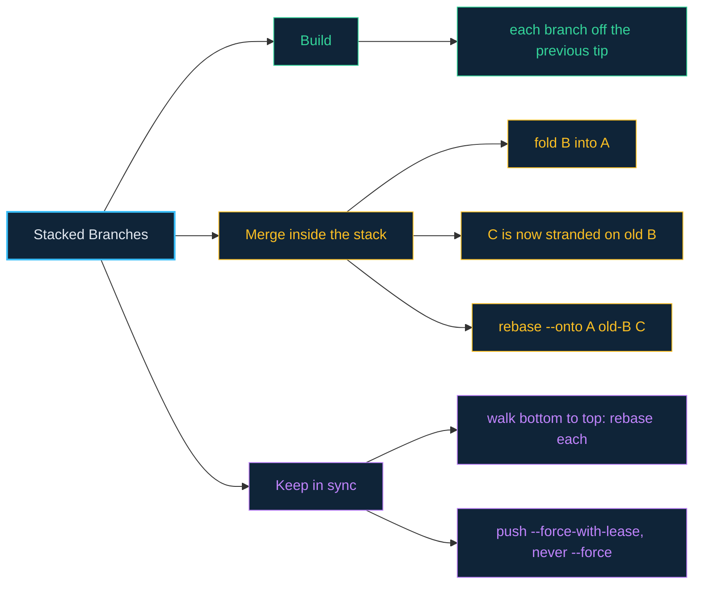

# 05 · Stacked Branches

> **The analogy.** Instead of three separate driveways all connecting to the main road, you build three driveways in a row, each one starting where the last one ends. Reviewing one big change becomes reviewing three small, dependent ones — but if you ever repave the first driveway, the two behind it need to be re-laid too, because their starting point just moved.

---

## 🎞️ Animation

**Building a stack: each branch forks from the tip of the one before it.**



**Restacking: when a lower branch changes, everything above it must be rebased.**



---

## 📐 Blueprint



---

## 🗺️ Mindmap



---

## ⚙️ Commands

**Building the stack.**

```bash
git checkout main
git switch -c feature-A        # bottom of the stack
#   ...commit A1, A2...
git push -u origin feature-A

git switch -c feature-B         # branches off feature-A, NOT main
#   ...commit B1, B2...
git push -u origin feature-B

git switch -c feature-C          # branches off feature-B
#   ...commit C1, C2...
git push -u origin feature-C
```

**Merging two branches inside the stack.** Once `feature-A` is approved and you fold `feature-B` into it, `feature-B`'s commits now have a *new* position in history — everything built on top (`feature-C`) is still pointing at the *old* B, and needs to be relocated ("restacked") onto the new A.

```bash
# 1. fold feature-B into feature-A
git checkout feature-A
git merge feature-B

# 2. before deleting feature-B, remember its OLD tip — the --onto pivot
old_b=$(git rev-parse feature-B)

# 3. move feature-C off the old feature-B and onto the new feature-A
git rebase --onto feature-A "$old_b" feature-C

# 4. clean up — feature-B's work now lives inside feature-A
git branch -d feature-B

# 5. once feature-A (with B folded in) is approved, merge it up to main
git checkout main
git merge feature-A
```

> **Why `rebase --onto` is the key move:** plain `git rebase feature-A` would replay *every* commit `feature-C` has over `feature-A`'s tip — but `feature-C`'s ancestry already includes B's old commits, so git would try to replay them a second time. `rebase --onto <new> <old> <branch>` explicitly says "take only the commits on `branch` that aren't on `old`, and replay just those onto `new`" — correctly skipping the B commits already folded into A.

**Keeping a stack in sync day to day.** Every time the bottom of the stack changes, everything above it needs restacking — bottom to top:

```bash
git checkout feature-A && git rebase main
git checkout feature-B && git rebase feature-A
git checkout feature-C && git rebase feature-B

git push --force-with-lease origin feature-A feature-B feature-C
```

> Always `--force-with-lease`, never bare `--force` — lease refuses the push if someone else updated the remote branch since you last fetched; bare force overwrites them silently.

<!-- py:ops_stacked:build_stack -->
```python
def build_stack(repo: str) -> dict[str, bool]:
    """feature-B forks from feature-A's tip, feature-C forks from feature-B's tip."""
    commit(repo, "base.txt", "0", "base")
    run(["switch", "-c", "feature-A"], repo)
    commit(repo, "a.txt", "a", "A work")
    run(["switch", "-c", "feature-B"], repo)
    commit(repo, "b.txt", "b", "B work")
    run(["switch", "-c", "feature-C"], repo)
    commit(repo, "c.txt", "c", "C work")
    is_anc = lambda base, branch: run_ok(["merge-base", "--is-ancestor", base, branch], repo).returncode == 0
    return {
        "A_is_ancestor_of_B": is_anc("feature-A", "feature-B"),
        "B_is_ancestor_of_C": is_anc("feature-B", "feature-C"),
        "A_is_ancestor_of_C": is_anc("feature-A", "feature-C"),
    }
```
<!-- /py -->

<!-- py:ops_stacked:restack_onto -->
```python
def restack_onto(repo: str) -> dict[str, bool]:
    """After feature-A gains new commits, feature-B must be rebased onto the new tip."""
    commit(repo, "base.txt", "0", "base")
    run(["switch", "-c", "feature-A"], repo)
    commit(repo, "a.txt", "a", "A work")
    run(["switch", "-c", "feature-B"], repo)
    commit(repo, "b.txt", "b", "B work")
    run(["switch", "feature-A"], repo)
    commit(repo, "a2.txt", "a2", "A gained review feedback")
    run(["switch", "feature-B"], repo)
    before = run_ok(["merge-base", "--is-ancestor", "feature-A", "feature-B"], repo).returncode == 0
    run(["rebase", "feature-A"], repo)
    after = run_ok(["merge-base", "--is-ancestor", "feature-A", "feature-B"], repo).returncode == 0
    return {"up_to_date_before_restack": before, "up_to_date_after_restack": after}
```
<!-- /py -->

---

## ⚠️ Risk & reversibility

| Command | Risk | Reversible? |
|:--|:--:|:--|
| building the stack (`switch -c` off a feature branch) | none | just branches, free to discard |
| folding B into A, then `rebase --onto` for C | medium | each step is a normal rebase/merge — `--abort` works mid-step; `reflog` covers the rest |
| `git push --force-with-lease` after restacking | low-medium | lease protects against clobbering others; a bare `--force` would not |

---

## ⚖️ Trade-offs

| ✅ Stack when | ❌ Don't stack when |
|:--|:--|
| one large change genuinely splits into dependent, individually-reviewable pieces | the pieces aren't actually dependent — just branch them all off `main` independently instead |
| your team has (or tolerates building) the discipline to restack promptly on feedback | review cycles are slow and the stack will sit half-stale for weeks |

> **In practice:** tools like `git-branchless`, Graphite, or `gh stack` exist specifically to automate the restacking in this module — the underlying mechanism is always repeated `rebase --onto` calls, bottom to top.

---

## 🃏 Flashcards

<details><summary>In a stack, does feature-B branch off main or off feature-A?</summary>

**Off feature-A's current tip.** That's the entire definition of a stack — branches chained to each other instead of all forking independently from main.
</details>

<details><summary>Why does feature-C get "stranded" when feature-B merges into feature-A?</summary>

feature-C's history still points at feature-B's *old* commits. Once those are folded into A and feature-B is deleted, feature-C's base no longer corresponds to anything actively maintained — it needs to be rebased onto the new A.
</details>

<details><summary>Why use <code>rebase --onto</code> instead of a plain <code>rebase feature-A</code> to fix feature-C?</summary>

feature-C's ancestry already contains feature-B's old commits. A plain rebase onto feature-A would try to replay those same changes a second time (since they're technically "new" relative to A). `--onto` explicitly excludes everything already on the old base, replaying only feature-C's own unique commits.
</details>

---

## ❓ Quiz

**1.** You have a 3-deep stack: A → B → C. Reviewers ask for a change on A. What's the minimum sequence of rebases to bring the whole stack up to date?

<details><summary>Answer</summary>

**Three, bottom to top:** `rebase main` on A (if A itself needed to move), then `rebase feature-A` on B, then `rebase feature-B` on C. Skipping a layer leaves that branch pointing at a stale ancestor.
</details>

**2.** Why `--force-with-lease` and not plain `--force` when pushing a restacked branch?

<details><summary>Answer</summary>

`--force-with-lease` checks that the remote branch is still at the commit you last fetched before overwriting it — if a teammate pushed something new in the meantime, the push is refused instead of silently destroying their work. Plain `--force` has no such check.
</details>

---

⬅️ [04 · Rebase](04-rebase.md) · [🏠 Index](../README.md) · [06 · Stashing](06-stashing.md) ➡️
