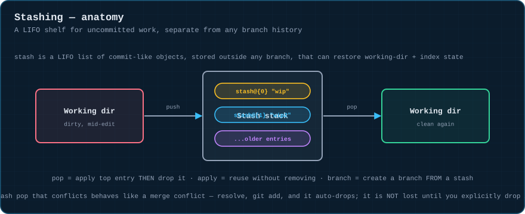
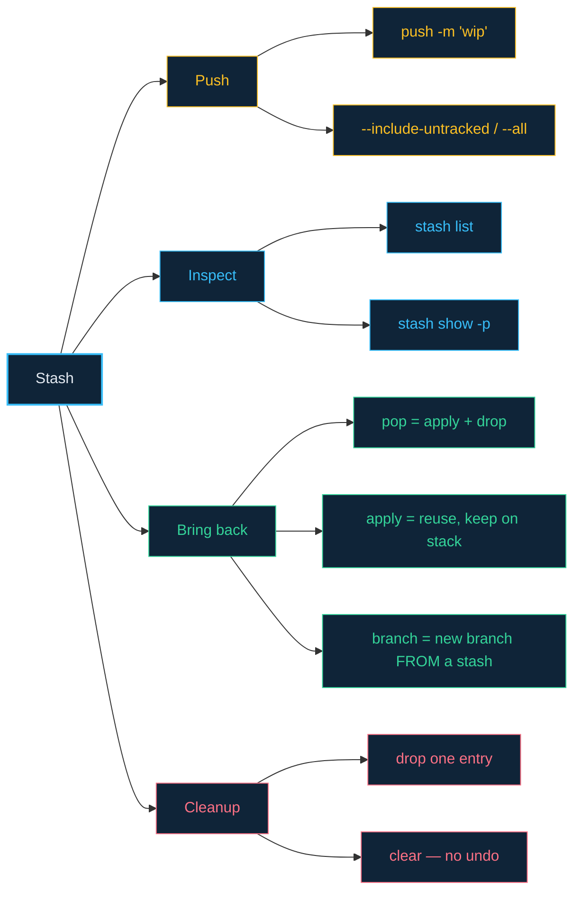

# 06 · Stashing — Shelving Work in Progress

> **The analogy.** You're mid-edit on a messy desk when someone needs you to drop everything. Stash is the drawer you sweep everything into — papers, half-finished notes and all — so the desk is clear. The drawer remembers things in the order you put them in; pulling the top item back out puts your desk back exactly how it was.

---

## 🎞️ Animation

**Push tucks dirty work away; pop brings it back.**



**The stash list is a LIFO stack.**



---

## 📐 Blueprint



---

## 🗺️ Mindmap



---

## ⚙️ Commands

**Stash.**

```bash
git stash                       # shorthand for: git stash push
git stash push -m "wip: refactor"    # named, easier to find later
git stash push -- src/app.ts     # only specific files
git stash -p                      # interactively choose hunks to stash
git stash --include-untracked      # also stash new (untracked) files
git stash --all                      # also stash ignored files
```

**Inspect.**

```bash
git stash list
git stash show -p stash@{0}      # view the diff inside a stash entry
```

**Bring it back.**

```bash
git stash pop                      # apply the newest entry, then remove it
git stash apply stash@{1}         # apply a specific, older entry — keeps it on the stack
git stash branch new-branch stash@{0}  # create a branch FROM a stash — best fix when pop conflicts
```

**Cleanup.**

```bash
git stash drop stash@{1}          # delete one entry without applying it
git stash clear                     # delete the whole stack — no undo
```

> If `git stash pop` conflicts, don't panic and don't drop the stash — resolve the conflict like a merge conflict, `git add` the resolved files, and the stash entry is automatically dropped once there's nothing left to apply. If it goes sideways, the stash is still safely in `git stash list` until you explicitly drop it.

<!-- py:ops_stash:stash_roundtrip -->
```python
def stash_roundtrip(repo: str) -> dict[str, object]:
    """push tucks dirty work away and gives back a clean tree; pop restores it."""
    commit(repo, "a.txt", "base", "base")
    write(repo, "a.txt", "dirty edit")
    dirty_before = run(["status", "--porcelain"], repo).strip()
    run(["stash", "push", "-m", "wip"], repo)
    clean_after_push = run(["status", "--porcelain"], repo).strip()
    run(["stash", "pop"], repo)
    dirty_after_pop = run(["status", "--porcelain"], repo).strip()
    return {
        "was_dirty_before": bool(dirty_before),
        "was_clean_after_push": clean_after_push == "",
        "dirty_again_after_pop": dirty_after_pop == dirty_before,
    }
```
<!-- /py -->

---

## ⚠️ Risk & reversibility

| Command | Risk | Reversible? |
|:--|:--:|:--|
| `git stash push` | none | the change is still fully there, just shelved |
| `git stash pop` that conflicts | low | behaves exactly like a merge conflict — resolve and `add`; the stash isn't dropped until clean |
| `git stash drop` | medium | the dropped entry is unreachable immediately; recoverable only via `git fsck --unreachable` if you're fast and lucky |
| `git stash clear` | **high** | deletes every entry on the stack at once, with no confirmation and no easy recovery |

---

## ⚖️ Trade-offs

| ✅ Stash when | ❌ Just commit instead when |
|:--|:--|
| you need to switch branches *right now* and aren't ready to commit | the work is actually done — a `wip` commit you can `reset --soft` later is often safer and more visible |
| the change is genuinely temporary scratch work | you'll want to push this machine's state to another machine — stashes are local only |

---

## 🃏 Flashcards

<details><summary>What exactly does <code>git stash push</code> shelve?</summary>

Both your working-directory changes **and** anything already staged — it restores the tree to match `HEAD`, tucking the difference away as a stash entry. Untracked files are only included with `--include-untracked`.
</details>

<details><summary>What's the difference between <code>stash pop</code> and <code>stash apply</code>?</summary>

`pop` applies the entry and then removes it from the stack. `apply` applies it but leaves it on the stack — useful when you want to bring the same stash into two different branches.
</details>

<details><summary>If <code>git stash pop</code> produces a conflict, is the stash entry lost?</summary>

**No.** It stays in `git stash list` until the conflict is fully resolved and there's nothing left to apply — only then does git drop it. You can always bail out and try `git stash apply` + manual resolution instead.
</details>

---

## ❓ Quiz

**1.** You stash twice without names: `stash@{0}` becomes which entry after a third `git stash push`?

<details><summary>Answer</summary>

**The newest one, every time.** `stash@{0}` always refers to whatever was pushed most recently — the index shifts, not the content. The one you pushed first is now `stash@{2}`.
</details>

**2.** You need the same stashed change applied to two different branches. Which command do you use, and why?

<details><summary>Answer</summary>

**`git stash apply`** (not `pop`) on the first branch, so the entry stays on the stack, then `git stash apply stash@{0}` again on the second branch. `pop` would have removed it after the first use.
</details>

---

⬅️ [05 · Stacked Branches](05-stacked-branches.md) · [🏠 Index](../README.md) · [07 · Cherry-Picking](07-cherry-picking.md) ➡️
