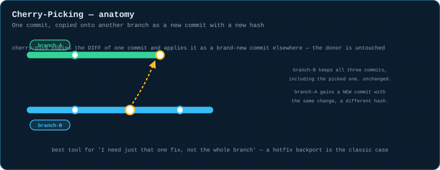
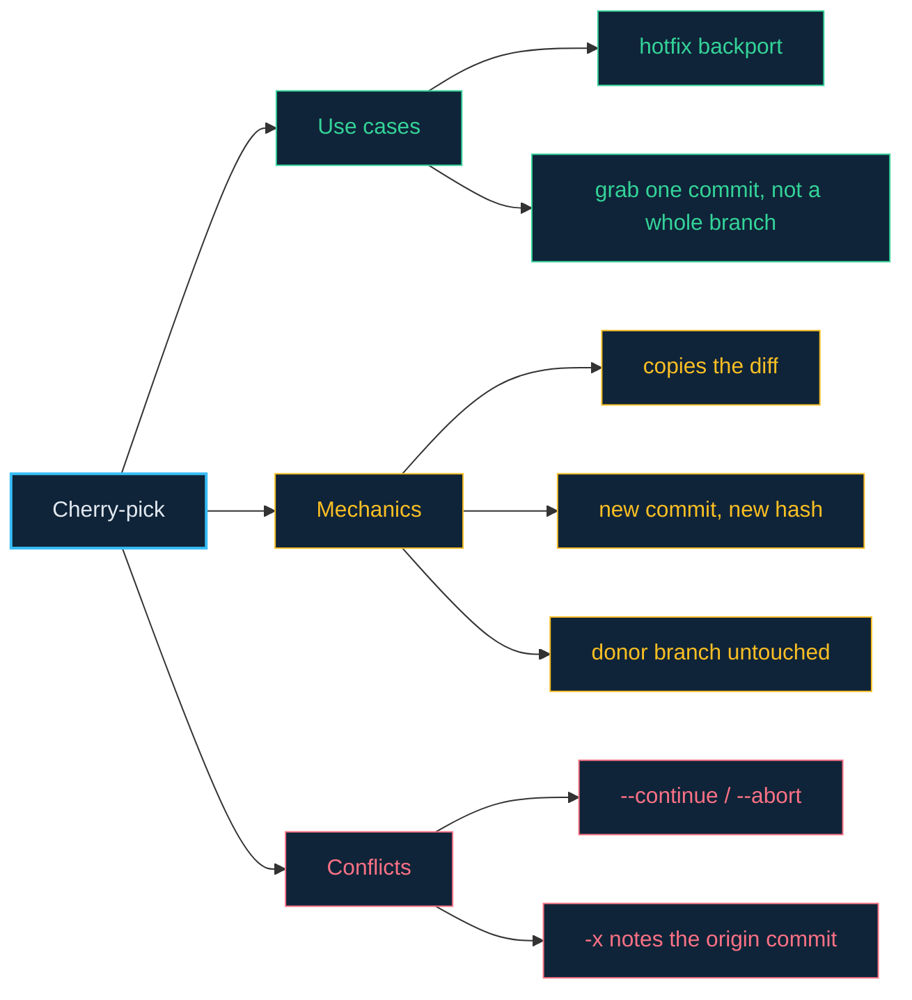

# 07 · Cherry-Picking — Moving Individual Commits

> **The analogy.** Rebase moves a whole truckload. Cherry-pick is reaching into someone else's truck, grabbing *one specific box*, and loading a copy onto your own — their truck drives off with every box still in it, yours just gained one.

---

## 🎞️ Animation

**Cherry-pick copies one commit; everything else on the donor stays put.**



---

## 📐 Blueprint



---

## 🗺️ Mindmap



---

## ⚙️ Commands

```bash
git cherry-pick abc1234                  # apply that one commit here
git cherry-pick abc1234^..def5678          # apply a range (abc1234 exclusive..def5678 inclusive)
git cherry-pick --no-commit abc1234         # stage the change, let you fold it into something else
git cherry-pick -x abc1234                   # append "(cherry picked from commit ...)" to the message
git cherry-pick --continue                     # after resolving a conflict
git cherry-pick --abort                          # bail out entirely
```

<!-- py:ops_cherry_pick:cherry_pick_one -->
```python
def cherry_pick_one(repo: str) -> dict[str, object]:
    """branch-B donates one commit to branch-A; branch-B stays fully intact."""
    commit(repo, "base.txt", "0", "base")
    run(["switch", "-c", "branch-B"], repo)
    commit(repo, "x.txt", "x", "unrelated work")
    picked = commit(repo, "fix.txt", "the fix", "the fix we need")
    commit(repo, "y.txt", "y", "more unrelated work")
    donor_history_before = log_messages(repo, "branch-B")
    run(["switch", "main"], repo)
    run(["cherry-pick", picked], repo)
    return {
        "branch_A_gained_the_fix": "the fix we need" in log_messages(repo, "main"),
        "branch_B_unchanged": log_messages(repo, "branch-B") == donor_history_before,
        "branch_A_commit_count": len(log_messages(repo, "main")),
    }
```
<!-- /py -->

---

## ⚠️ Risk & reversibility

| Command | Risk | Reversible? |
|:--|:--:|:--|
| `git cherry-pick <sha>` (clean) | low | `git reset --hard HEAD~1` removes it immediately, since it's just a normal new commit |
| cherry-pick with conflicts | low | `--abort` returns you to the pre-pick state |
| cherry-picking a merge commit (`-m`) | medium | behaves subtly — picks only the diff relative to one named parent; easy to get wrong without checking the result |

---

## ⚖️ Trade-offs

| ✅ Cherry-pick when | ❌ Use rebase/merge instead when |
|:--|:--|
| you need exactly one fix, not the rest of a branch's history (the classic hotfix backport) | you want a whole branch's work, in order — that's what merge and rebase are for |
| the donor branch must stay completely untouched | you're trying to permanently relocate a branch — that's rebase's job ([module 04](04-rebase.md)) |

---

## 🃏 Flashcards

<details><summary>Does cherry-pick remove the commit from the branch you picked it from?</summary>

**No.** The donor branch is completely untouched — cherry-pick only reads the diff from that commit and applies a **copy** as a new commit elsewhere, with a new hash.
</details>

<details><summary>What does the <code>-x</code> flag add?</summary>

A trailer line, `(cherry picked from commit <sha>)`, appended to the new commit's message — a breadcrumb for anyone later wondering where a backported fix came from.
</details>

---

## ❓ Quiz

**1.** You cherry-pick commit `abc1234` from `branch-B` onto `main`. Does `abc1234` still exist on `branch-B`?

<details><summary>Answer</summary>

**Yes, unchanged.** Cherry-pick never modifies the source branch — `main` simply gains a new commit with the same diff and a different hash.
</details>

**2.** When is cherry-pick the wrong tool, even though it would technically work?

<details><summary>Answer</summary>

When you actually want **the whole branch's history** moved or combined, in order — repeatedly cherry-picking every commit one at a time reinvents rebase (module 4) or merge (module 3) badly, and loses the explicit relationship those tools record.
</details>

---

⬅️ [06 · Stashing](06-stashing.md) · [🏠 Index](../README.md) · [08 · Branching Strategies](08-branching-strategies.md) ➡️
