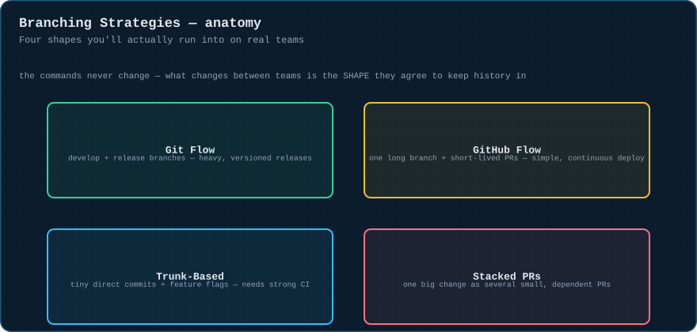
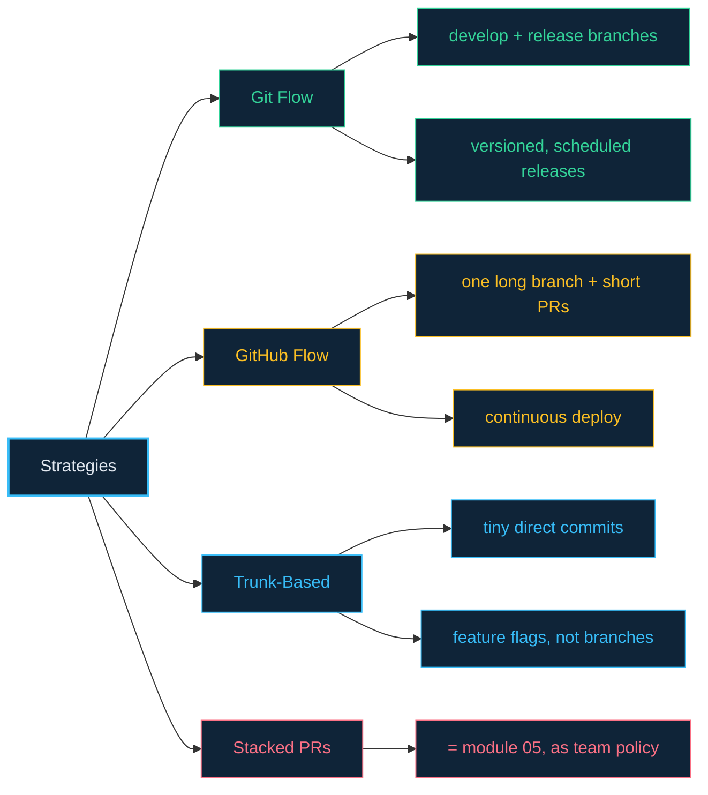

# 08 · Branching Strategies

> **The analogy.** The commands in modules 02–07 are the alphabet. A branching strategy is the house style a team agrees to write in — some teams write formal letters (Git Flow), some write quick notes (GitHub Flow), some barely use punctuation at all (trunk-based). None of the letters change; only the shape of what you build with them does.

---

## 🎞️ Animation

**Trunk-based: many small commits land directly on trunk, no long-lived branches.**



---

## 📐 Blueprint



---

## 🗺️ Mindmap



---

## ⚙️ Commands

The commands are the same everywhere — what differs is which ones a team agrees to use, and when.

| Pick this when… | Strategy |
|:--|:--|
| You ship dated, versioned releases (desktop/mobile app, firmware) | **Git Flow** — separate `develop` + `release/*` + `hotfix/*` branches |
| You deploy continuously and want the simplest possible model | **GitHub Flow** — one long branch, short feature branches merged via PR |
| You have strong CI/tests and want to minimize merge pain entirely | **Trunk-Based** — tiny direct commits, unfinished work behind feature flags |
| One change is genuinely large but splits into reviewable, dependent pieces | **Stacked PRs** — [module 05](05-stacked-branches.md), as a team-wide policy |

<!-- py:ops_strategies:trunk_based_commits -->
```python
def trunk_based_commits(repo: str, n: int) -> dict[str, object]:
    """Trunk-based: many small commits land directly on main, no feature branches."""
    for i in range(n):
        commit(repo, f"f{i}.txt", str(i), f"small change {i}")
    return {"commit_count": len(log_messages(repo)), "branch_count": len(run(["branch"], repo).strip().splitlines() or [""])}
```
<!-- /py -->

<!-- py:ops_strategies:github_flow_branch -->
```python
def github_flow_branch(repo: str) -> dict[str, bool]:
    """GitHub flow: one short-lived branch, merged straight back via PR, then deleted."""
    commit(repo, "base.txt", "0", "base")
    run(["switch", "-c", "feature/short-lived"], repo)
    commit(repo, "x.txt", "x", "the change")
    run(["switch", "main"], repo)
    run(["merge", "--no-ff", "feature/short-lived"], repo)
    run(["branch", "-d", "feature/short-lived"], repo)
    remaining = run(["branch", "--format=%(refname:short)"], repo).strip().splitlines()
    return {"branch_cleaned_up": "feature/short-lived" not in remaining, "change_landed_on_main": True}
```
<!-- /py -->

---

## ⚠️ Risk & reversibility

Strategy choice isn't risky the way a command is — the risk here is **mismatch**: adopting Git Flow's ceremony for a product that deploys fifty times a day, or trunk-based commits-straight-to-main for a team with no CI and no feature flags. Both are fully reversible (you can always change convention) but costly to live with while mismatched.

---

## ⚖️ Trade-offs

| ✅ Strategy | Cost | Benefit |
|:--|:--|:--|
| Git Flow | ceremony, more branches to track | clear separation between in-progress and released work |
| GitHub Flow | less structure for complex release trains | simple, fast, matches continuous deployment |
| Trunk-based | requires mature CI, tests, and flag discipline | near-zero merge pain, fastest feedback loop |
| Stacked PRs | requires restacking discipline ([module 05](05-stacked-branches.md)) | large changes get reviewed in digestible, dependent pieces |

---

## 🃏 Flashcards

<details><summary>What's the core trade Git Flow makes?</summary>

More structure (separate `develop`, `release/*`, `hotfix/*` branches) in exchange for a clear boundary between "in progress" and "released" — valuable when releases are dated and versioned, overkill for continuous deployment.
</details>

<details><summary>How does trunk-based development get safety without feature branches?</summary>

From **feature flags** plus fast, trustworthy CI — unfinished work ships to trunk but stays dark behind a flag until it's ready, rather than being isolated on a branch.
</details>

---

## ❓ Quiz

**1.** Your team ships a mobile app with dated version numbers (1.2, 1.3, ...) and needs to patch older versions independently. Which strategy fits best, and why?

<details><summary>Answer</summary>

**Git Flow.** Its `release/*` and `hotfix/*` branches exist exactly for maintaining and patching specific shipped versions in parallel with ongoing development on `develop`.
</details>

---

⬅️ [07 · Cherry-Picking](07-cherry-picking.md) · [🏠 Index](../README.md) · [09 · Undoing Things](09-undoing-things.md) ➡️
