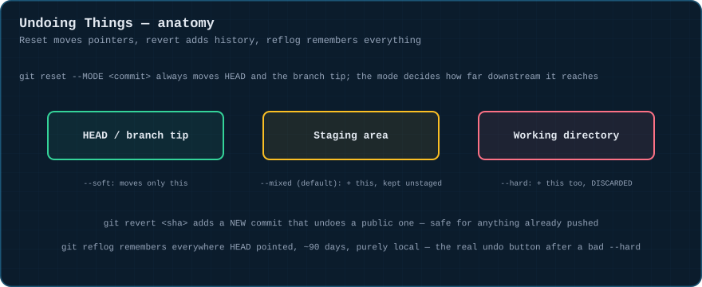
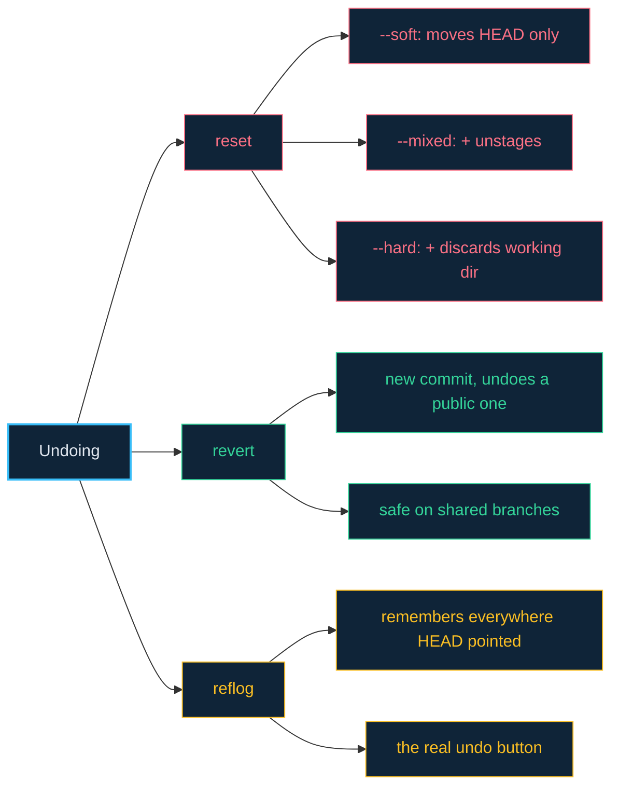

# 09 · Undoing Things — Reset, Revert, Reflog

> **The analogy.** `reset` is rewinding a tape — you choose how far back, and whether to erase what's after the point you rewound to. `revert` is writing a correction into the record rather than tearing out the old page. `reflog` is the security camera that keeps recording regardless of what you do to the tape — it's how you find your way back even after a bad rewind.

---

## 🎞️ Animation

**The three reset modes reach progressively further.**



**Revert adds; a hard reset on a pushed branch erases.**



---

## 📐 Blueprint



---

## 🗺️ Mindmap



---

## ⚙️ Commands

```bash
# move the branch pointer, choose what else follows it
git reset --soft HEAD~1    # undo last commit, keep changes staged
git reset HEAD~1               # (--mixed, default) undo commit AND staging, keep working dir
git reset --hard HEAD~1       # undo commit, staging, AND working dir changes — destructive

# undo a PUBLISHED commit safely — adds a new commit, doesn't rewrite history
git revert abc1234
git revert --no-commit abc1234..def5678   # revert a range, one combined commit

# the panic button: reflog remembers where HEAD and branches pointed, even after reset --hard
git reflog
git reset --hard HEAD@{2}        # jump back to exactly where you were 2 moves ago
git branch recovered abc1234    # turn a "lost" commit you found in reflog back into a real branch
```

> **Reflog is your real undo button.** It keeps ~90 days of everywhere HEAD has pointed on this machine (not pushed anywhere, purely local) — a "lost" commit from a bad `reset --hard` or an aborted rebase is almost always still sitting in `git reflog`, reachable by hash.

<!-- py:ops_undoing:reset_soft_mixed_hard -->
```python
def reset_soft_mixed_hard(repo: str, mode: str) -> dict[str, object]:
    """--soft keeps staging; --mixed (default) unstages but keeps the file; --hard discards it."""
    commit(repo, "a.txt", "1", "first")
    commit(repo, "a.txt", "2", "second")
    head_before = rev(repo)
    run(["reset", f"--{mode}", "HEAD~1"], repo)
    return {
        "head_moved": rev(repo) != head_before,
        "status": run(["status", "--porcelain"], repo).strip(),
    }
```
<!-- /py -->

<!-- py:ops_undoing:reflog_recovers_a_lost_commit -->
```python
def reflog_recovers_a_lost_commit(repo: str) -> dict[str, bool]:
    """reflog remembers every place HEAD pointed, even after a hard reset."""
    commit(repo, "a.txt", "1", "first")
    lost = commit(repo, "a.txt", "2", "second - about to be lost")
    run(["reset", "--hard", "HEAD~1"], repo)
    gone_from_log = lost not in run(["log", "--format=%H"], repo)
    reflog_hashes = run(["reflog", "--format=%H"], repo).splitlines()
    recoverable = lost in reflog_hashes
    run(["branch", "recovered", lost], repo)
    restored = lost in run(["log", "--format=%H", "recovered"], repo)
    return {"gone_from_main_log": gone_from_log, "visible_in_reflog": recoverable, "restored_via_new_branch": restored}
```
<!-- /py -->

---

## ⚠️ Risk & reversibility

| Command | Risk | Reversible? |
|:--|:--:|:--|
| `git reset --soft` | none | nothing is discarded, only HEAD moves |
| `git reset --mixed` (default) | low | unstages, but working-dir content is untouched |
| `git reset --hard` | **high** | discards working-dir AND staged changes; the *commits* are recoverable via reflog, but **uncommitted edits at the time of the reset are gone for good** |
| `git revert` | none | it's an ordinary new commit — revert the revert if needed |
| `git reflog` itself | none | read-only; it's the safety net, not a risk |

---

## ⚖️ Trade-offs

| ✅ Use this | When |
|:--|:--|
| `reset --soft` | you want to redo a commit message or regroup commits, keeping all changes staged |
| `reset --hard` | you're certain you want to throw away local commits *and* uncommitted edits — on a branch nobody else has pulled |
| `revert` | the bad commit is already pushed/shared — never `reset --hard` something others have pulled |
| `reflog` | anything went wrong and you need to find out where you actually were |

---

## 🃏 Flashcards

<details><summary>What's the one thing all three reset modes have in common?</summary>

All three **move HEAD and the branch pointer** to the target commit. They differ only in how far downstream — into staging, and then into the working directory — that move also reaches.
</details>

<details><summary>Why is <code>revert</code> safe on a shared branch when <code>reset --hard</code> is not?</summary>

`revert` **adds** a new commit; it never removes or rewrites existing history, so collaborators' clones stay perfectly compatible. `reset --hard` moves the branch pointer backward, which — if pushed — erases commits other people may already have pulled and built on.
</details>

<details><summary>You ran <code>git reset --hard</code> and lost a commit. Is it gone?</summary>

**Almost certainly not**, if it was ever committed. `git reflog` keeps a local record of everywhere HEAD has pointed for about 90 days; `git branch recovered <hash>` turns a hash you find there back into a normal, checked-out-able branch.
</details>

---

## ❓ Quiz

**1.** You committed twice, then realize you want those two commits combined into one with a better message, keeping the changes. What command sequence?

<details><summary>Answer</summary>

**`git reset --soft HEAD~2`**, then `git commit -m "better message"`. Soft reset rewinds two commits' worth of history while leaving everything staged, so the next commit recombines them.
</details>

**2.** A teammate asks you to undo commit `abc123`, which already shipped to production three days ago. What do you run, and what do you avoid?

<details><summary>Answer</summary>

**`git revert abc123`.** Avoid `git reset --hard` on the shared branch — that would rewrite history collaborators (and your deployed environment's git history, if it tracks commits) already depend on.
</details>

---

⬅️ [08 · Branching Strategies](08-branching-strategies.md) · [🏠 Index](../README.md) · [10 · Remote Workflows](10-remote-workflows.md) ➡️
