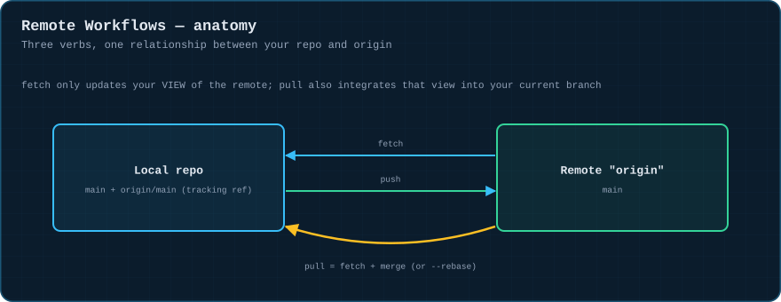
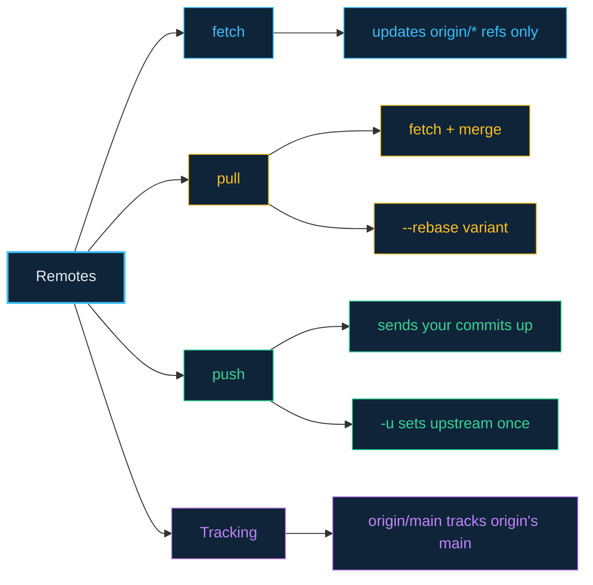

# 10 · Remote Workflows

> **The analogy.** Think of the remote as a shared mailbox down the street. `fetch` is walking down and reading what's in it without bringing anything home. `pull` is fetching and then actually merging those letters into your own desk. `push` is dropping your own letters off for everyone else to fetch.

---

## 🎞️ Animation

**Fetch only updates your view; pull also integrates it.**



**The upstream tracking label advances after a push.**



---

## 📐 Blueprint



---

## 🗺️ Mindmap



---

## ⚙️ Commands

```bash
git remote add origin git@github.com:user/repo.git
git remote -v

git fetch origin                    # update origin/* refs, touch nothing of yours
git pull                               # fetch + merge into current branch
git pull --rebase                     # fetch + rebase current branch onto it instead

git push                               # push current branch to its upstream
git push -u origin feature/x        # push AND set upstream tracking, once
git push --force-with-lease          # after a rebase — safe-ish force push

git branch --set-upstream-to=origin/main main   # fix tracking without pushing
```

> If `git pull` on a branch you rebased locally throws a pile of conflicts that make no sense, you probably want `git pull --rebase` (or set `git config pull.rebase true` globally) — a plain merge-pull re-merges histories that rebase already diverged.

<!-- py:ops_remotes:fetch_vs_pull -->
```python
def fetch_vs_pull(bare: str, local: str) -> dict[str, object]:
    """fetch only updates origin/main; pull also merges it into your branch."""
    other = tempfile.mkdtemp(prefix="gitviz-other-")
    try:
        run(["clone", "-q", bare, other], os.path.dirname(other))
        run(["config", "user.email", "test@example.com"], other)
        run(["config", "user.name", "Test"], other)
        run(["config", "commit.gpgsign", "false"], other)
        pushed = commit(other, "b.txt", "2", "someone else's change")
        run(["push", "-q"], other)

        run(["fetch", "-q"], local)
        local_main_unchanged = rev(local, "main") != pushed
        remote_ref_updated = rev(local, "origin/main") == pushed

        run(["pull", "-q"], local)
        local_main_now_matches = rev(local, "main") == pushed
        return {
            "after_fetch_main_unchanged": local_main_unchanged,
            "after_fetch_tracking_ref_updated": remote_ref_updated,
            "after_pull_main_updated": local_main_now_matches,
        }
    finally:
        shutil.rmtree(other, ignore_errors=True)
```
<!-- /py -->

---

## ⚠️ Risk & reversibility

| Command | Risk | Reversible? |
|:--|:--:|:--|
| `git fetch` | none | read-only against your branches; only updates `origin/*` tracking refs |
| `git pull` (merge) | low | behaves like any merge — `reset --hard ORIG_HEAD` undoes an unwanted one |
| `git pull --rebase` | low-medium | can replay local commits awkwardly if there are conflicts; `--abort` works mid-way |
| `git push` | low | adds commits remotely; doesn't destroy anything unless combined with `--force` |
| `git push --force` | **high** | can overwrite others' pushed commits with no warning — prefer `--force-with-lease` always |

---

## ⚖️ Trade-offs

| ✅ Use this | When |
|:--|:--|
| `git fetch` + inspect before merging | you want to see what changed before integrating it |
| `git pull` (merge) | the default, safe choice on a shared branch |
| `git pull --rebase` | you keep a linear local history and the branch is yours alone |
| `git push --force-with-lease` | you rebased and need to update a remote branch you own |

---

## 🃏 Flashcards

<details><summary>What's the one-sentence difference between fetch and pull?</summary>

`fetch` updates your knowledge of the remote (`origin/main`) without touching your own branch. `pull` does that fetch, then immediately merges (or rebases) that knowledge into your current branch.
</details>

<details><summary>What does <code>git push -u origin feature/x</code> do that a plain push doesn't?</summary>

Sets the **upstream tracking relationship** between your local `feature/x` and the remote one — after that, plain `git push`/`git pull` on this branch know where to go without naming the remote again.
</details>

---

## ❓ Quiz

**1.** You run `git fetch`, then `git log main..origin/main`. What are you looking at?

<details><summary>Answer</summary>

**Commits that exist on the remote's main but not yet on your local main** — exactly what a `git pull` would bring in, inspected *before* you actually merge it.
</details>

---

⬅️ [09 · Undoing Things](09-undoing-things.md) · [🏠 Index](../README.md) · [11 · The Advanced Toolbox](11-advanced-toolbox.md) ➡️
