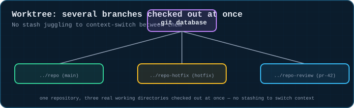
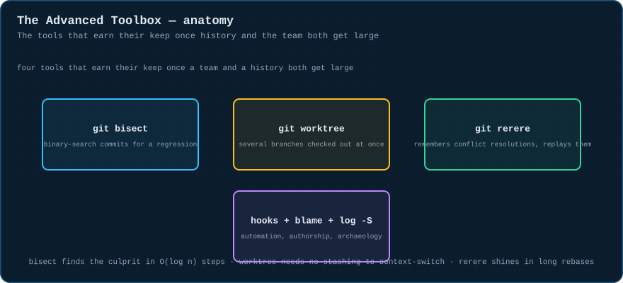
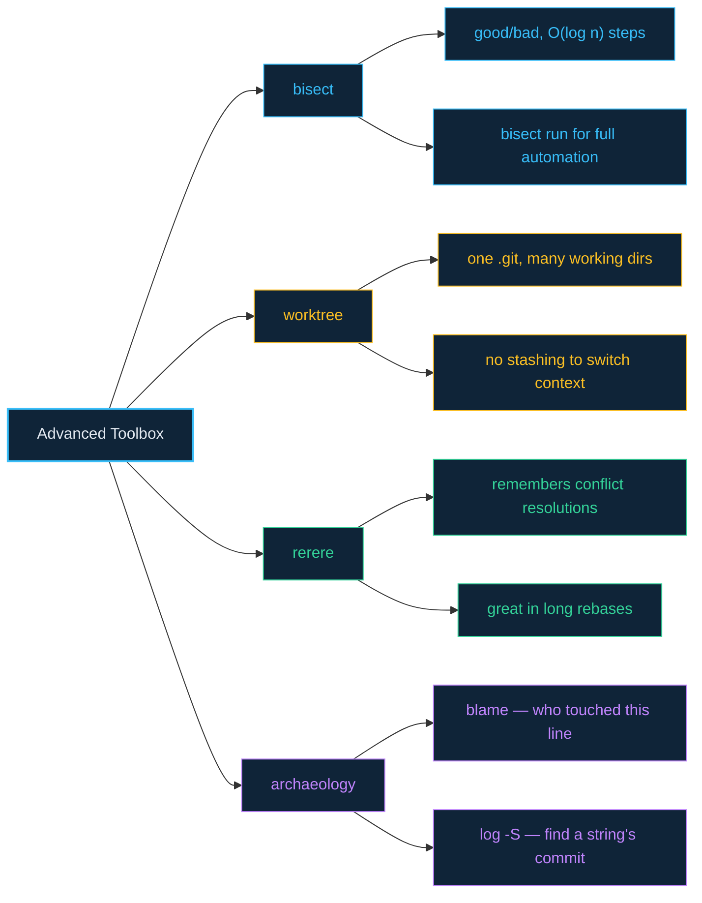

# 11 · The Advanced Toolbox

> **The analogy.** Bisect is a metal detector that halves the beach with every sweep instead of walking every inch. Worktree is having several desks wired to the same filing cabinet, so you can work on three things at once without boxing anything up. Rerere is a notepad that remembers how you solved a puzzle last time, in case you hit the exact same puzzle again.

---

## 🎞️ Animation

**Bisect binary-searches your history for a regression.**



**Worktree checks out several branches at once.**



---

## 📐 Blueprint



---

## 🗺️ Mindmap



---

## ⚙️ Commands

**Bisect — binary-search for the commit that broke something.**

```bash
git bisect start
git bisect bad                   # current commit is broken
git bisect good v1.2.0          # this older tag/commit was fine
#   ...git checks out a midpoint, you test it...
git bisect good   # or: git bisect bad — repeat until git names the culprit
git bisect reset               # done — return to where you started
git bisect run ./test.sh      # fully automated, if you have a script that exits non-zero on "bad"
```

**Worktree — multiple branches checked out at once.**

```bash
git worktree add ../repo-hotfix hotfix          # new working dir, existing branch
git worktree add -b review/pr-42 ../repo-review origin/pr-42
git worktree list
git worktree remove ../repo-hotfix
```

**A few more worth knowing.**

```bash
git rerere                           # "reuse recorded resolution" — remembers how you resolved a
                                      # conflict, auto-applies it next time you hit the same one
git config rerere.enabled true

git blame path/to/file.ts            # who/which commit last touched each line
git log -S "exact text"                # find the commit that added/removed a literal string
git log --follow -- old-renamed.ts   # history across a rename

# hooks — scripts .git/hooks/ runs automatically
.git/hooks/pre-commit                  # run lint/tests before allowing a commit
.git/hooks/pre-push                    # run tests before allowing a push

git submodule add <url> vendor/lib   # embed another repo at a pinned commit
git submodule update --init --recursive
```

<!-- py:ops_advanced:bisect_finds_the_culprit -->
```python
def bisect_finds_the_culprit(repo: str, good_count: int, bad_count: int) -> dict[str, object]:
    """git bisect run narrows a good..bad range to the exact breaking commit."""
    commits = [_commit_state(repo, i, "good") for i in range(good_count)]
    culprit = _commit_state(repo, good_count, "bad")
    commits.append(culprit)
    commits += [_commit_state(repo, good_count + 1 + i, "bad") for i in range(bad_count)]

    script = os.path.join(repo, "check.sh")
    write(repo, "check.sh", "#!/bin/sh\ngrep -q good status.txt\n")
    os.chmod(script, 0o755)

    run(["bisect", "start"], repo)
    run(["bisect", "bad", "HEAD"], repo)
    run(["bisect", "good", commits[0]], repo)
    run_ok(["bisect", "run", "sh", "check.sh"], repo)
    log = run(["bisect", "log"], repo)
    run(["bisect", "reset"], repo)
    return {"culprit_identified": culprit[:12] in log, "repo_restored_to_main": rev(repo) == commits[-1]}
```
<!-- /py -->

<!-- py:ops_advanced:worktree_parallel_checkouts -->
```python
def worktree_parallel_checkouts(repo: str) -> dict[str, object]:
    """One .git database, several real working directories checked out simultaneously."""
    commit(repo, "a.txt", "1", "base")
    run(["branch", "hotfix"], repo)
    extra_dir = tempfile.mkdtemp(prefix="gitviz-worktree-")
    shutil.rmtree(extra_dir)
    try:
        run(["worktree", "add", extra_dir, "hotfix"], repo)
        listing = run(["worktree", "list"], repo)
        main_head = rev(repo, "main")
        hotfix_head = rev(extra_dir, "HEAD")
        return {
            "second_working_dir_created": os.path.isdir(extra_dir),
            "both_worktrees_listed": listing.count("\n") >= 1,
            "same_commit_shared": main_head == hotfix_head,
        }
    finally:
        run_ok(["worktree", "remove", "--force", extra_dir], repo)
        shutil.rmtree(extra_dir, ignore_errors=True)
```
<!-- /py -->

---

## ⚠️ Risk & reversibility

| Command | Risk | Reversible? |
|:--|:--:|:--|
| `git bisect start/good/bad/run` | none | read-only exploration of history; `bisect reset` returns you exactly where you started |
| `git worktree add/remove` | low | each worktree is an independent checkout; removing one doesn't touch the shared `.git` database or other worktrees |
| `git rerere` | low | only ever *replays* a resolution you already made once by hand; double-check its result on anything high-stakes |
| `git submodule` operations | medium | pinned-commit mismatches between a submodule and its parent repo are a common source of "works on my machine" |

---

## ⚖️ Trade-offs

| ✅ Reach for this | When |
|:--|:--|
| `bisect` | a regression exists somewhere in a long, unfamiliar range of commits and you have a reliable pass/fail test |
| `worktree` | you need to context-switch between branches without stashing, or run a long build on one branch while coding on another |
| `rerere` | a long-running rebase or merge keeps throwing the *same* conflict repeatedly |
| `blame` / `log -S` | you need to understand *why* a line exists, not just that it does |

---

## 🃏 Flashcards

<details><summary>Why is bisect's step count O(log n) rather than O(n)?</summary>

Each test halves the remaining range of commits — exactly like binary search over a sorted array. A thousand-commit range narrows to the culprit in about ten tests instead of up to a thousand.
</details>

<details><summary>What does <code>git worktree</code> avoid that switching branches normally requires?</summary>

Stashing. Each worktree is its own real directory with its own checked-out branch, all sharing one `.git` object database — so you can have three branches checked out and buildable simultaneously, no shelving required.
</details>

---

## ❓ Quiz

**1.** A bug was introduced somewhere in the last 500 commits and you have a script that exits non-zero when the bug is present. What's the fastest way to find the exact commit?

<details><summary>Answer</summary>

**`git bisect start`, mark the current state `bad` and an old known-good commit `good`, then `git bisect run ./your-script.sh`.** Git will automatically check out midpoints and run the script until it names the exact commit — roughly 9 steps for 500 commits (log₂ 500 ≈ 9).
</details>

---

⬅️ [10 · Remote Workflows](10-remote-workflows.md) · [🏠 Index](../README.md) · [Command cheat sheet](cheatsheet-commands.md) ➡️
