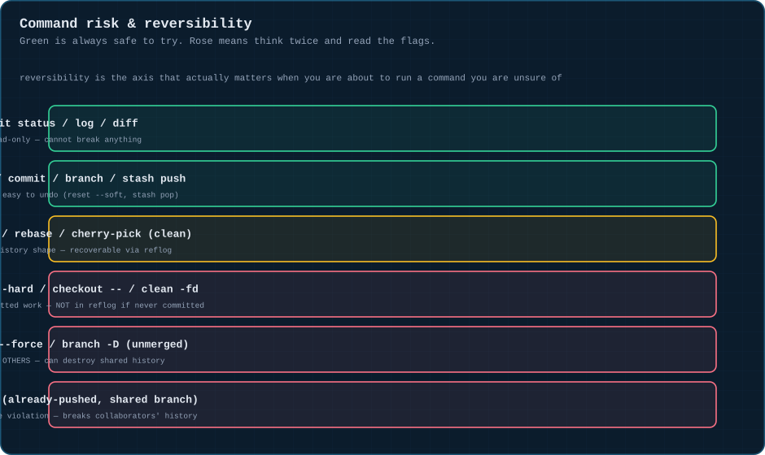

# 📋 Command cheat sheet

Everything in the repo, on one page. Print it, or keep it open in a tab.

---

## ⚠️ The risk matrix

---

## Setup & state

| Command | What it does |
|:--|:--|
| `git init` / `git clone <url>` | start a repo / copy one down |
| `git status` | what's changed, staged, untracked |
| `git log --oneline --graph --all` | the whole commit graph, compactly |

## Staging & committing — [module 01](01-three-trees.md)

| Command | What it does |
|:--|:--|
| `git add -p` | stage selected hunks, not whole files |
| `git diff` / `git diff --staged` | working-dir↔staging / staging↔repository |
| `git commit --amend` | fix the message or contents of the last commit |

## Branching — [module 02](02-branching-basics.md)

| Command | What it does |
|:--|:--|
| `git switch -c name` | create + check out a branch |
| `git branch -d` / `-D` | safe delete (refuses if unmerged) / force delete |

## Merging & rebasing — [modules 03](03-merging.md) & [04](04-rebase.md)

| Command | What it does |
|:--|:--|
| `git merge name` / `--no-ff` / `--squash` | combine histories |
| `git rebase name` / `-i` / `--onto` | replay commits onto a new base |

## Stacked branches — [module 05](05-stacked-branches.md)

| Command | What it does |
|:--|:--|
| `git rebase --onto new old branch` | move `branch` from `old` base to `new` base |
| `git push --force-with-lease` | push a rebased branch without clobbering others' work |

## Stashing — [module 06](06-stashing.md)

| Command | What it does |
|:--|:--|
| `git stash push -m "msg"` | shelve current changes |
| `git stash pop` / `apply` / `list` / `drop` | restore / reuse / view / delete a shelf entry |

## Moving commits — [module 07](07-cherry-picking.md)

| Command | What it does |
|:--|:--|
| `git cherry-pick <sha>` | copy one commit elsewhere |

## Undoing — [module 09](09-undoing-things.md)

| Command | What it does |
|:--|:--|
| `git reset --soft` / `--mixed` / `--hard` | rewind HEAD, choosing what follows |
| `git revert <sha>` | undo a public commit via a new commit |
| `git reflog` | the panic button — find anything HEAD has pointed to |

## Remotes — [module 10](10-remote-workflows.md)

| Command | What it does |
|:--|:--|
| `git fetch` / `pull` / `pull --rebase` / `push` | sync with origin |

## Advanced — [module 11](11-advanced-toolbox.md)

| Command | What it does |
|:--|:--|
| `git bisect start` / `good` / `bad` / `reset` | binary-search for a breaking commit |
| `git worktree add <path> <branch>` | check out another branch in parallel, no stash needed |
| `git blame` / `git log -S"text"` | find who/when/which-commit for a line or a string |

---

⬅️ [❓ Quiz](quiz.md) · [🏠 Index](../README.md)
